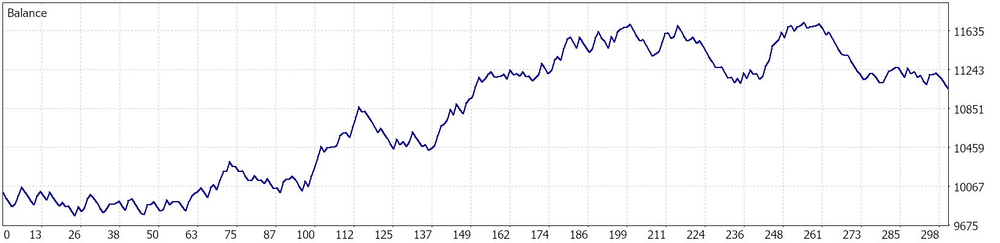
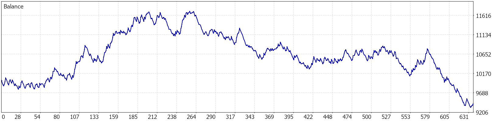
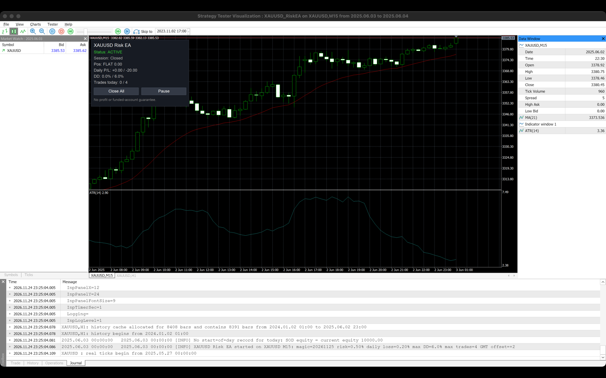
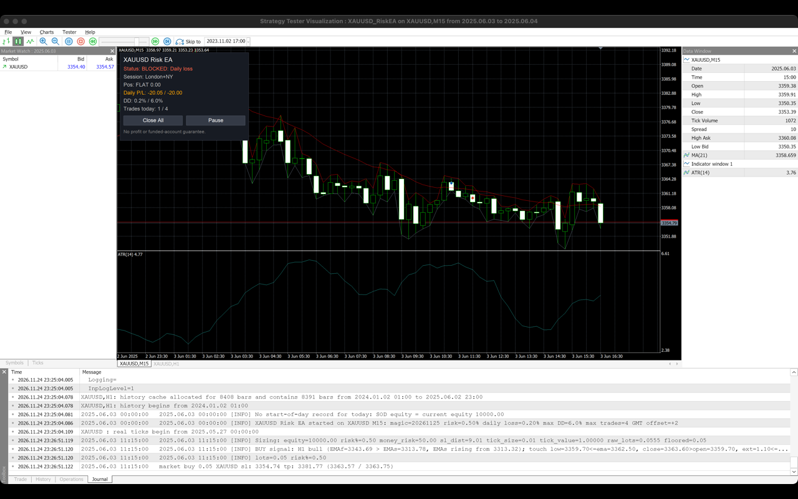
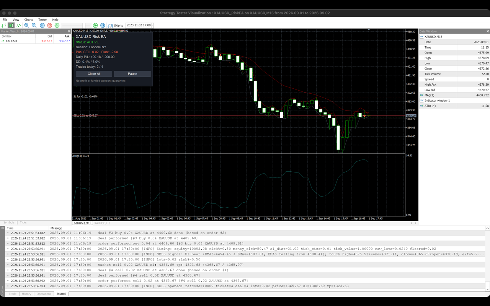
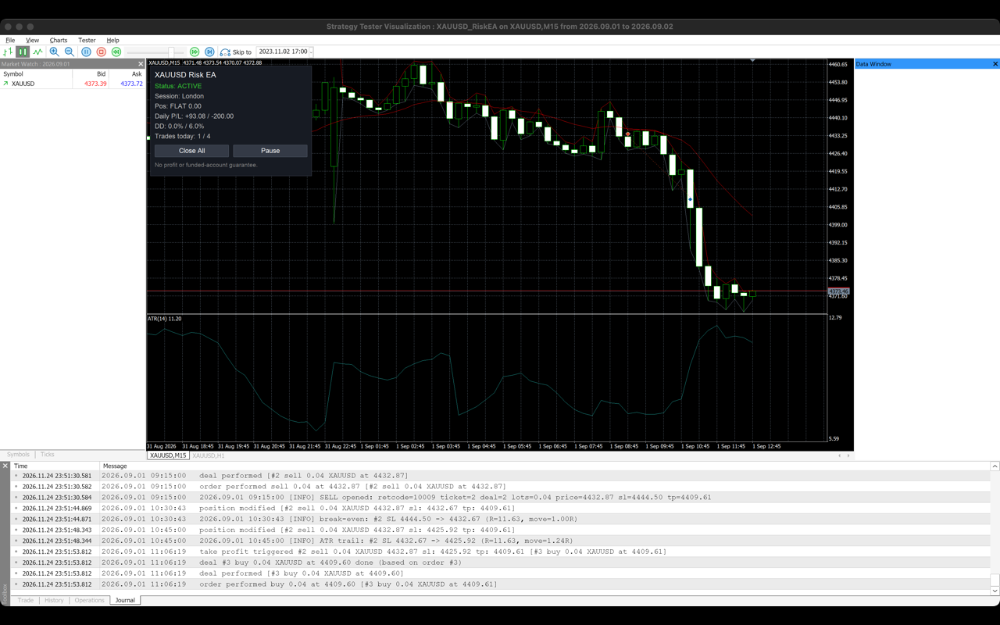

# XAUUSD MT5 EA with Risk Engine and On-Chart Panel

## What this is

A single-symbol Expert Advisor for MetaTrader 5 that trades XAUUSD on M15. It uses an H1 EMA 50/200 trend filter and an M15 EMA 21 pullback entry confirmed by the closing candle. Every signal is computed on closed bars only, so signals do not repaint. Lots are sized from a fixed % of equity. A risk engine can stop the EA: daily max loss, max drawdown from the equity high, max trades per day, spread, London/New York sessions and a Friday cutoff. An on-chart panel shows the EA's state and has Close All and Pause/Resume buttons. This is a coding showcase for a custom MT5 EA offer, not a profit claim.

## Features

- **Gold / XAUUSD**: built and tested on XAUUSD M15. The EA refuses to start on any other timeframe, and logs a warning if the symbol name contains neither `XAU` nor `GOLD`.
- **On-chart panel**: status (`ACTIVE` / `PAUSED` / `BLOCKED: <reason>`), session, open positions with floating P/L, daily P/L vs limit, drawdown vs limit, trades today, **Close All** and **Pause / Resume** buttons.
- **Risk engine**:
  - **Daily max loss**: a % of start-of-day equity, or a fixed amount of money. When it is hit, the EA closes all its positions and blocks new trades until the next server date.
  - **Max drawdown** from the equity high-water mark: closes all positions and blocks new trades. The lock survives new days and Resume.
  - Max entries per day and a max-spread filter.
- **Session filter**: London (07:00–16:00 GMT) and New York (12:00–21:00 GMT) windows. GMT is derived from server time with a configurable server GMT offset.
- **Friday rules**: no new entries from 16:00 GMT, close all at 16:30 GMT, blocked until Monday.
- **Break-even and ATR trailing**: break-even at 1 R plus a buffer, then an ATR trail based on the last closed bar. The stop only ever tightens.
- **Multi-timeframe**: H1 trend filter, M15 entry.
- **No martingale, no grid**: one position per direction, risk-sized lots only, no add-ons, no recovery multiplier. The executor refuses any order whose volume differs from a fresh risk-% calculation, and every entry logs `lots=X risk%=Y`.

## Inputs

The default values live in [`sets/XAUUSD_M15.set`](sets/XAUUSD_M15.set). Load that file rather than relying on a copy of the defaults here. The groups are:

- **Execution**: magic number, trade comment, slippage, allow buys / sells.
- **Strategy**: H1 fast/slow EMA, M15 entry EMA, ATR period, SL = ATR x multiplier, TP = SL x risk-reward, max extension from the EMA (in ATR).
- **Risk**:
  - Risk % per trade and an optional max lot.
  - Daily loss mode (percent or money) and its limit, max drawdown %, max trades per day, max spread.
  - Break-even trigger and buffer, ATR trail start and distance.
  - `InpClearRiskLocks`: clears persisted locks on the next attach.
- **Session**: server GMT offset, London and New York windows (GMT, end time exclusive), Friday no-new and close-all times (GMT).
- **Panel**: show / hide, corner, X/Y offset, font size, refresh period.
- **Logging**: `LOG_ERROR`, `LOG_INFO` or `LOG_DEBUG`. Use `LOG_DEBUG` to see the decision on every bar.

### Server GMT offset

Set `InpServerGmtOffset` to your broker's offset, where server time = GMT + offset. DST is not handled automatically, so change the value when the season changes. Many EU-based brokers use:

| Season | Server time | `InpServerGmtOffset` |
| --- | --- | --- |
| Winter (Nov–Mar) | GMT+2 | 2 |
| Summer (Mar–Oct) | GMT+3 | 3 |

### Start-of-day equity and persisted state

The daily loss limit is measured against start-of-day (SOD) equity. On the first tick of a new server date, the EA saves the current equity as SOD equity. SOD equity, the SOD date, the daily-loss and max-DD locks, the equity high-water mark and the user pause flag are all kept in terminal Global Variables prefixed `XAU_RISK_EA_`. Restarting the terminal or re-attaching the EA on the same day therefore does not reset the day.

If the EA is first attached mid-day and no record exists for today, SOD equity is set to the current equity at attach time.

The max-DD lock never clears on its own. It clears only when the EA is re-attached with `InpClearRiskLocks = true`, which also resets the high-water mark to current equity.

## Install

1. Copy `MQL5/Experts/XAUUSD_RiskEA.mq5` into `<Data Folder>/MQL5/Experts/`.
2. Copy the folder `MQL5/Include/XAUUSD_RiskEA/` into `<Data Folder>/MQL5/Include/`. To find the data folder, use File > Open Data Folder in MT5.
3. Open `XAUUSD_RiskEA.mq5` in MetaEditor and compile it (expected result: 0 errors, 0 warnings).
4. Open an **XAUUSD M15** chart and attach the EA.
5. In the Inputs tab, click **Load** and pick `sets/XAUUSD_M15.set`.
6. Set `InpServerGmtOffset` to your broker's current GMT offset.
7. Enable **Algo Trading** in the toolbar.

## How to test

Strategy Tester settings for the main run:

- **Expert**: `XAUUSD_RiskEA`. **Symbol**: `XAUUSD`. **Period**: `M15`.
- **Model**: *Every tick based on real ticks*. If your broker has no real ticks for the window, switch broker or data; do not fall back to "1 minute OHLC".
- **Dates**: the longest window with 100% real ticks, ideally 2 years or more (e.g. 2024.01.01 – 2026.11.01).
- **Deposit**: 10,000. Hedging account.
- **Inputs**: load `sets/XAUUSD_M15.set`.
- **Visual mode**: off for the 2-year run. Use it on a short recent slice to check the panel and buttons. The visual tester does not send chart click events, so the EA reads the button state on its timer there.

Forced risk-limit checks (short ranges, visual mode where a panel check is needed):

| # | Check | Setting | Expected result |
| --- | --- | --- | --- |
| 1 | Daily loss | `InpDailyLossPercent = 0.2` | Position closed, `BLOCKED: Daily loss`, no entries until the next server date |
| 2 | Max DD | `InpMaxDrawdownPercent = 0.5` | Close all and `BLOCKED: Max DD`. The lock survives new days and Resume, and clears on re-attach with `InpClearRiskLocks = true` |
| 3 | Max trades | `InpMaxTradesPerDay = 1` | Second signal of the day logged as skipped: `max trades` |
| 4 | Spread | `InpMaxSpreadPoints = 0` | Signals logged as skipped: `spread`. Open trades are not closed |
| 5 | Session | Both sessions off, then London only | No entries at all, then entries only inside London hours (GMT via the offset) |
| 6 | Friday | Run across a Friday | No entries from 16:00 GMT; log line `Close all (Friday close)` at 16:30 GMT |
| 7 | Sizing | Compare the `Sizing:` log line with the hand formula below | Same lots, floored to the volume step |
| 8 | No martingale | Trade after a loss | Lots come from a fresh risk-% calculation, not a multiple of the previous lot |
| 9 | Buttons | Visual mode | Close All flattens the EA's positions. Pause stops new entries. Resume does not clear a risk lock |
| 10 | No repaint | Two identical runs | Same trades: same bars, same direction |

Hand formula for check 7:

```
lots = floor( equity * risk% / 100 / (SL_distance / tick_size * tick_value) / step ) * step
```

## Test results

All runs: MetaTrader 5 build 6230, MetaQuotes-Demo data, XAUUSD M15, *Every tick based on real ticks*, 10,000 USD deposit, hedging, leverage 1:500. Sizing is risk-based, so leverage only affects the margin check.

**Why 17 months instead of 2 years:** MetaQuotes-Demo only has real XAUUSD ticks from 2025.05.27. A 2024–2026 run on this server reports "50% real ticks", meaning the tester generated half the ticks, so it is not used as the deliverable. The deliverable runs use 2025.06.01 – 2026.11.01, which is 100% real ticks. On a broker with a longer real-tick history, rerun the same set file over 2+ years.

| Run | Inputs | Net profit | Max equity DD | Profit factor | Trades | Report |
| --- | --- | --- | --- | --- | --- | --- |
| Main | `sets/XAUUSD_M15.set` (6% max-DD lock) | +1,051.10 (+10.5%) | 5.99% | 1.16 | 300 | [htm](docs/reports/tester_default_2025-06_2026-11.htm) |
| Comparison | same, but `InpMaxDrawdownPercent = 50` (lock effectively off) | -539.47 (-5.4%) | 20.74% | 0.96 | 636 | [htm](docs/reports/tester_dd_lock_off_2025-06_2026-11.htm) |

What the comparison shows: on its own, the entry logic is roughly break-even on this period. In the main run, the max-DD lock fired on 2026.02.05 at 6.02% below the equity peak (peak 11,758, equity 11,051). It closed the position and blocked all new trades for the rest of the test. Without the lock, the same signals went on to a 20.7% drawdown. The risk engine, not the entry, decided the outcome, and that is what this project demonstrates. It is not a claim that the strategy is profitable.





Forced acceptance checks. They ran on short real-tick windows from 2025–2026, on Vantage and MetaQuotes demo data; results are from the tester journals.

| Check | Result |
| --- | --- |
| Compile | 0 errors, 0 warnings (MetaEditor build 6230) |
| Daily loss 0.2% | Lock at daily P/L -20.10 vs limit -20.00. Position closed, the day's remaining signals skipped as `blocked (Daily loss)`, lock cleared at the next server date |
| Max DD 0.5% | Lock at 0.51%. Close all, 0 entries for the remaining 6 weeks of the test, across new days |
| Max trades = 1 | Never more than 1 entry per day; 80 signals skipped as `max trades` |
| Spread = 0 | 0 entries; every signal skipped as `spread`; no position closed |
| Sessions off / London only | 0 entries with both off. With London only, entries between 09:00 and 17:45 server time, which is 07:00–15:45 GMT at offset +2 |
| Friday | 0 entries after 16:00 GMT on Fridays; `Close all (Friday close)` at 16:30 GMT |
| Sizing | 1,393 logged entries checked against the formula: 0 mismatches, never rounded up |
| No martingale | Every entry is a fresh risk-% size from current equity and SL distance, including after losses |
| No repaint | Two identical runs produced identical entries (same bars, direction, price, lots) |
| Daily trading break | SL modify, close and entry are skipped while the broker trade session is closed. 2.8-year run: 0 errors |

## Screenshots

Panel in the visual tester, `ACTIVE`, before the session opens:



Daily-loss lock with `InpDailyLossPercent = 0.2`. The buy was closed when daily P/L reached -20.05 against the -20.00 limit, and the panel shows `BLOCKED: Daily loss`. The journal shows the sizing line and the buy signal with its reasons:



Open sell on the chart with its SL and entry lines. The panel shows the position and its floating P/L during the London+NY overlap. The journal shows the `Sizing:`, `SELL signal:` and `lots=0.02 risk%=0.50` lines:



A full trade in the journal: sell entry, break-even at 1 R, ATR trail, take profit:



## Disclaimer

This Expert Advisor is a coding portfolio piece. It does not guarantee profit, maximum drawdown, or success in any funded-account evaluation.

There is no profit guarantee, no drawdown guarantee and no promise of passing FTMO or any other funded-account evaluation. Strategy Tester results are not live results. Run it on a demo account first.

## License / reuse

The source code is published for Ugo Coppola's portfolio and for client conversations. It is not a licence to republish, resell or list it as a market product without his written permission.
